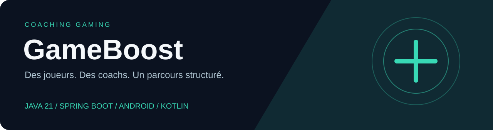
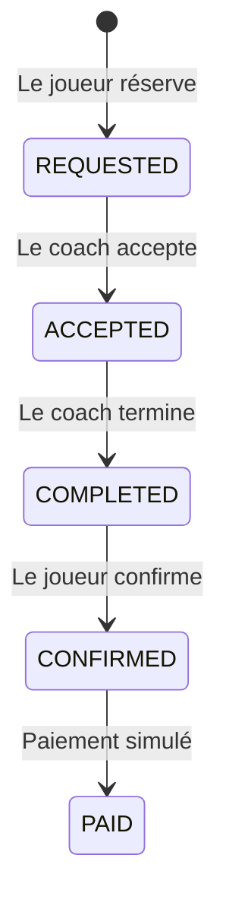

<p align="center"></p>

<p align="center">
  
  
  
  
</p>

**Une plateforme académique de coaching gaming : trouver un coach, réserver une séance, échanger et évaluer la prestation.**

Cette version présente le travail collectif de [GameBoost](https://github.com/tahaelidrissi/GameBoost), avec une contribution backend de Mohammed KSSIRI. Elle conserve l'historique et ajoute une documentation actualisée, les documents de conception retrouvés et des corrections vérifiées. Voir [attribution](docs/ATTRIBUTION.md).

**[Architecture](docs/ARCHITECTURE.md) · [API et lancement](backend/README.md) · [Vérifications](docs/VERIFICATION.md) · [Conception initiale](docs/history/SystemDesign-original.md)**

## Ce qui fonctionne aujourd'hui

| Partie | Périmètre |
|---|---|
| API Spring Boot | Authentification JWT, rôles, profils coachs, réservation, transitions des séances, messages, avis et administration |
| Application Android | Écrans Compose et ViewModels pour joueurs, coachs et administrateurs, avec données en mémoire |
| Intégration mobile/API | **À réaliser** : les ViewModels utilisent actuellement `MockRepository` |
| Paiement | Simulation de changement d'état ; aucun prestataire de paiement intégré |

### Le parcours d'une séance



Les transitions sont contrôlées côté service. Seuls le joueur ou le coach concernés peuvent agir. Une séance payée peut recevoir un avis ; le chat devient disponible après acceptation.

## Stack

- **Backend :** Java 21, Spring Boot 3.4.4, Spring Security, JWT, Spring Data JPA, MySQL.
- **Mobile :** Kotlin, Jetpack Compose, ViewModel et StateFlow.
- **Tests :** JUnit, Mockito, MockMvc, H2 et JaCoCo pour le backend ; JUnit et tests de coroutines côté Android.

## Démarrage rapide

```bash
git clone https://github.com/KSSIRI05/GameBoost.git
cd GameBoost
```

### Vérifier le backend sans MySQL

Installer Java 21 et Maven 3.9+, puis :

```bash
cd backend
mvn verify
```

Les tests utilisent H2 en mémoire. Le rapport de couverture est généré dans `backend/target/site/jacoco/index.html`. Les résultats mesurés et les exclusions de couverture sont détaillés dans [VERIFICATION.md](docs/VERIFICATION.md).

### Lancer l'API avec MySQL

Créer un utilisateur MySQL et une base `gameboost_db`, puis définir les variables d'environnement `DB_URL`, `DB_USERNAME`, `DB_PASSWORD` et `JWT_SECRET`. La clé JWT doit être aléatoire et comporter au moins 32 octets. Spring Boot ne charge pas automatiquement un fichier `.env`.

Exemple PowerShell (remplacer les paramètres MySQL) :

```powershell
$env:DB_URL = 'jdbc:mysql://localhost:3306/gameboost_db'
$env:DB_USERNAME = 'gameboost'
$env:DB_PASSWORD = 'votre-mot-de-passe-local'
$env:JWT_SECRET = [Convert]::ToBase64String([Security.Cryptography.RandomNumberGenerator]::GetBytes(48))
cd backend
mvn spring-boot:run
```

API : `http://localhost:8080`. Consulter les [routes et exemples](backend/README.md). L'inscription publique permet uniquement les rôles `JOUEUR` et `COACH` ; la création d'un administrateur doit passer par une opération d'administration de la base.

### Ouvrir l'application Android

Ouvrir le dossier `frontend/` dans Android Studio, installer le SDK Android 34 et renseigner le SDK local via Android Studio ou `ANDROID_HOME`. Ne pas versionner `local.properties`.

```powershell
cd frontend
.\gradlew.bat testDebugUnitTest assembleDebug
```

Sous Linux/macOS : `./gradlew testDebugUnitTest assembleDebug`. L'application utilise son propre jeu de données en mémoire : un compte créé dans l'API n'apparaît pas automatiquement dans le mobile. Le compte administrateur de démonstration est défini dans `MockRepository.kt` et ne correspond pas à un compte backend.

## Organisation

```text
backend/                  API REST Spring Boot et tests
frontend/                 Application Android et tests
docs/ARCHITECTURE.md       Architecture réellement implémentée
docs/VERIFICATION.md       Résultats et limites des vérifications
docs/history/             Spécification initiale restaurée de Git
.github/workflows/        Vérifications automatisées
```

## Évolutions utiles

- Remplacer `MockRepository` par un client HTTP et un stockage sécurisé des jetons.
- Ajouter des tests d'intégration MySQL et des tests de parcours sur émulateur.
- Introduire une pagination et des DTO de réponse homogènes.
- Intégrer un prestataire de paiement si le projet dépasse le cadre de la démonstration.

Les tests et la revue réalisés ne constituent pas une validation de mise en production. Le document historique décrit la vision initiale ; la documentation actuelle précise les écarts constatés.
