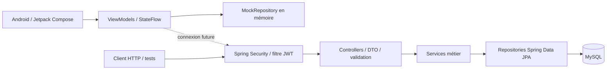

# Architecture actuelle de GameBoost

## Deux modules, une intégration à terminer

Le backend est un monolithe en couches, pas une architecture en microservices. Le frontend mobile est un prototype autonome : aucun adaptateur HTTP ne remplace encore `MockRepository`.

## Responsabilités backend

| Couche | Responsabilité |
|---|---|
| `controllers/` | Routes HTTP, validation des DTO, extraction de l'identité connectée |
| `services/` | Règles d'accès, approbation des coachs, transitions et calcul des montants |
| `repositories/` | Accès aux entités via Spring Data JPA |
| `models/` | `User`, `CoachProfile`, `Session`, `Message`, `Review` |
| `security/`, `config/` | JWT signé avec une clé HMAC, BCrypt, authentification sans session HTTP |
| `exceptions/` | Traduction des exceptions en réponses HTTP |

### Identité et autorisations

L'inscription accepte `JOUEUR` et `COACH`. Les routes `/auth/**` sont publiques, `/admin/**` exigent `ADMIN`, les autres exigent une authentification. Les méthodes coach utilisent aussi `@PreAuthorize`. Les services vérifient l'appartenance des séances et conversations.

Les mots de passe sont hachés avec BCrypt et exclus de la sérialisation JSON, y compris lorsqu'un utilisateur apparaît dans une entité imbriquée. La clé de signature est fournie par `JWT_SECRET`. Aucun rafraîchissement ou mécanisme de révocation des JWT n'est implémenté ici.

### Modèle et cycle métier

- `User` possède un UUID et un rôle.
- `CoachProfile` associe un utilisateur à un jeu, un rang et un tarif horaire.
- `Session` relie un joueur à un profil coach. Le montant est calculé à la réservation.
- Les états sont `REQUESTED → ACCEPTED → COMPLETED → CONFIRMED → PAID`.
- Le paiement est simulé. Les revenus sont la somme des séances marquées `PAID`.
- `Message` appartient à une séance ; l'envoi exige l'acceptation préalable.
- `Review` appartient à une séance payée ; le service empêche un second avis.

## Document historique retrouvé

[SystemDesign-original.md](history/SystemDesign-original.md) est restauré à l'identique depuis le commit [`fc06dff`](https://github.com/tahaelidrissi/GameBoost/commit/fc06dffe62a314a5d81395a0021c151e3a4b403f), chemin original `SystemDesign.md`. Il ne remplace pas la présente description du code.

Écarts notables :

- Les technologies y étaient proposées comme alternatives ; l'implémentation retient Spring Boot / MySQL et Android Kotlin.
- Les UUID utilisateurs remplacent les identifiants numériques de certains exemples.
- Les réponses utilisent l'enveloppe `ApiResponse` : consulter les contrôleurs pour le contrat exact.
- Le « chat en temps réel » de la vision initiale est une API REST de messages, sans WebSocket.
- Le frontend n'est pas encore connecté au backend.
- L'endpoint de création d'un profil coach est `POST /coaches/profile`.

## Limites de la revue

La revue porte sur le code, les tests, la configuration et les builds exécutés, détaillés dans [VERIFICATION.md](VERIFICATION.md). Elle ne valide pas un déploiement public, une charge concurrente, une infrastructure de production ou un paiement réel.
